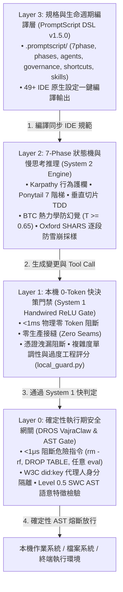
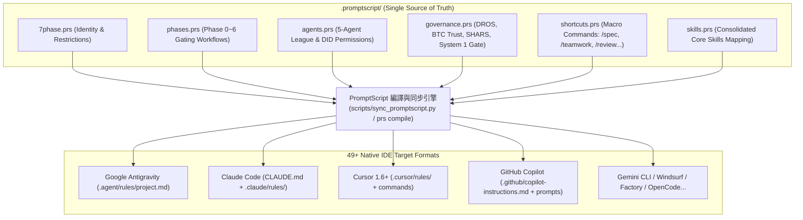
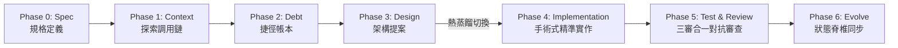
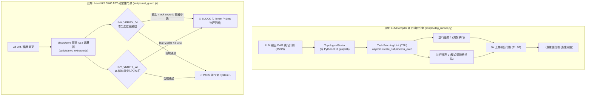

# 🚀 7-Phase Agentic Workflow (7 階段代理人協作與 Token 經濟學架構)

> **版本**：v3.3 (Unified 3-in-1 Adversarial Audit, Direct Surgical Write, Handwired ReLU & Skill Consolidation Edition)  
> **適用環境**：Google Antigravity, Claude Code, Cursor, Windsurf, GitHub Copilot, Gemini CLI, Factory, OpenCode 等 49+ 款主流 AI 開發環境  
> **核心理念**：Token 經濟學優先 (Token-First)、零非必要生產接縫 (Zero Production Seams)、消除雙倍手抄稅 (Direct Surgical Write)、三審合一對抗審查 (Unified 3-in-1 Adversarial Audit)、本機 0-Token 物理阻斷 (Handwired ReLU Guard)、熱力學防幻覺 (BTC Trust) 與長任務自適應熱蒸餾 (SelfCompact)。

---

本專案是一套專為現代 AI Coding 設計的**高吞吐量、低 Token 能耗、零生產接縫的全流程多代理人開發協作架構**。透過結合**原子級手術式直寫 (Direct Surgical Write)**、**三審合一對抗審查 (Unified 3-in-1 Adversarial Audit)**、**按需參考庫架構 (On-Demand References, 單檔 ≤15KB)** 以及本機 **<1ms Handwired ReLU 0-Token 決策門禁 (`local_guard.py`)**，在確保企業級工程品質與安全邊界的同時，最大化上下文利用率與系統吞吐量。

---

## 📌 目錄 (Table of Contents)

1. [🏛️ 四層認知架構與多軌防禦體系 (Cognitive Architecture)](#️-四層認知架構與多軌防禦體系-cognitive-architecture)
2. [⚡ 核心技術機制與 Token 經濟架構 (Core Technical Mechanisms)](#-核心技術機制與-token-經濟架構-core-technical-mechanisms)
3. [🔄 PromptScript 跨 IDE 編譯架構 (PromptScript Universal Compiler)](#-promptscript-跨-ide-編譯架構-promptscript-universal-compiler)
4. [🌟 核心理念與護欄 (Core Philosophy & Guardrails)](#-核心理念與護欄-core-philosophy--guardrails)
5. [🗺️ 7-Phase 協作生命週期標準作業程序 (The 7-Phase SOP)](#️-7-phase-協作生命週期標準作業程序-the-7-phase-sop)
6. [🤖 多代理人模式對比 (Multi-Agent Modes Matrix)](#-多代理人模式對比-multi-agent-modes-matrix)
7. [🧮 核心演算法與數學公式 (Core Algorithms & Formulas)](#-核心演算法與數學公式-core-algorithms--formulas)
8. [🎯 巨集指令手冊 (Macro Commands Reference)](#-巨集指令手冊-macro-commands-reference)
9. [🧩 技能模組盤點 (Skills Index)](#-技能模組盤點-skills-index)
10. [⚡ 雙引擎底層架構：SWC AST 確定性門禁與 LLMCompiler 並行排程](#-雙引擎底層架構swc-ast-確定性門禁與-llmcompiler-並行排程)
11. [🔍 開源專案與技能引入前置殘酷審查 SOP (Pre-Flight Gate)](#-開源專案與技能引入前置殘酷審查-sop-pre-flight-gate)
12. [📁 專案結構 (Project Structure)](#-專案結構-project-structure)
13. [🤖 安裝與快速上手指南 (Installation & Quickstart)](#-安裝與快速上手指南-installation--quickstart)

---

## 🏛️ 四層認知架構與多軌防禦體系 (Cognitive Architecture)

本框架構建了從物理執行期、微秒級快思考，到宏觀工程規格的多層縱深防禦體系：



---

## ⚡ 核心技術機制與 Token 經濟架構 (Core Technical Mechanisms)

### 1. 原子手術式直寫 (Direct Surgical Write)
在多代理人協作模式下，Worker 代理人具備受控沙盒或目標路徑的原子編輯權限（`replace_file_content` / `write_to_file`），直接對目標代碼區段執行手術式寫入，並僅向主控端回傳精簡變更摘要（≤3 行）。此設計消除了子代理人在對話視窗傾倒全檔 Markdown 再由主控複製貼上的雙倍 I/O Token 開銷。

### 2. 三審合一對抗審查 (Unified 3-in-1 Adversarial Audit)
Phase 5 審查階段採用單一高規格對抗審查機制，預設以 **REJECT (駁回)** 立場接手，於單次 Context 載入中並行完成三大維度驗收：
* **語意與風格校準 (Reviewer)**：檢驗命名契約、型別嚴密性與 Ponytail 精簡階梯合規度。
* **盲點紅隊反思 (Critic)**：針對邊界條件、競態條件 (Race Conditions) 與異常處理進行壓力挑刺。
* **資安與架構審計 (Auditor)**：檢驗零非必要生產接縫 (Zero Production Seams)、OWASP 弱點與模組耦合度。

### 3. 顯式調度門禁 (Manual Explicit Dispatch)
系統嚴格區分任務規模與調度邊界：
* **單兵作業（預設）**：日常開發與小型修改（<3 檔案）強制採單兵直寫模式，結合 Ponytail 7 階梯最小化變更。
* **多代理人軍團（顯式觸發）**：5 人品質制衡軍團 (`/teamwork`) 與 7 人全端工作室 (`/agy-studio`) 僅在工程師明確下達指令或跨模組大型架構重構經授權後啟動，防止輕量任務遭受多代理人調度稅。

### 4. 核心技能模組化與按需參考庫 (Modular Skills & On-Demand References)
所有頂層技能模組（`skills/*/SKILL.md`）嚴格遵守 **≤15KB 檔案上限**，確保常駐或喚醒時不污染主上下文視窗。高深領域規範與延伸框架細節（如 GSAP 動效、Cinematic 光影、CRO 落地頁模型、OWASP 清單、Mocking 準則等）一律拆分為 `./references/*.md`，僅在觸發對應子任務時按需動態載入 (Lazy Loading)。

### 5. 本機 System 1 0-Token 決策門禁 (Handwired ReLU Gate)
`scripts/local_guard.py` 實作無分支 6 維特徵 ReLU 線性網路 ($\mathbf{h}=\text{ReLU}(\mathbf{W}\mathbf{x}+\mathbf{b})$) 與靜態語意分析，提供 **<1ms、0 Token 開銷** 的提交前物理攔截：
* **零生產接縫檢驗 (`INV_VERIFY_03`)**：攔截生產代碼中僅為配合測試而開的後門（如 `@visibleForTesting`、`export /* test-only */`、可選 mock 注入參數）。
* **硬編碼憑證阻斷**：正則與熵值掃描 AWS、Stripe、Google、JWT 與私鑰字串。
* **歷史決策防翻案 (`INV_DECISION_01`)**：比對 `.agent/SNAPSHOT.jsonl` 中的 `ruled_out` 歷史決策，自動攔截重蹈覆轍的退化寫法。
* **隨插即用後端**：支援相容 `/v1/systemone` 協議之本機決策模型（Ollaya / Laya），離線時 0 延遲自動運行 Handwired ReLU 引擎。

---

## 🔄 PromptScript 跨 IDE 編譯架構 (PromptScript Universal Compiler)

本框架以 **PromptScript DSL (v1.5.0)** 作為代理人系統的**單一真實來源 (Single Source of Truth, SSOT)**。只需維護 `.promptscript/` 目錄下的宣告式模組，即可透過編譯引擎自動同步至各家 AI 編輯器格式：



---

## 🌟 核心理念與護欄 (Core Philosophy & Guardrails)

### 1. Karpathy 4 大行為護欄 (Surgical Precision)
源自 Andrej Karpathy 對於 LLM Coding 陷阱的實戰體悟，本架構在 Prompt 層級硬性約束 Agent 的行為邊界：
* **主動反駁 (Push Back)**：發現需求過度工程化或有更簡解法時，必須主動反駁，提出最精簡方案。
* **零投機 (No Speculation)**：嚴禁為一次性邏輯建立超前包裝、通用工廠或非必要介面。
* **精準開刀 (Surgical Precision)**：非必要絕不擴大修改範圍；鄰近無關的死代碼僅列入報告，嚴禁順便刪改。
* **困惑即停 (Stop When Confused)**：遇到需求矛盾或規格隱患，立即停下發問，拒絕盲目通靈猜測。

### 2. Ponytail 資深偷懶工程師 7 階梯 (The Lazy Senior Dev Mode)
如同房間裡最偷懶的資深工程師：**最好的代碼就是從未寫過的代碼**。
寫代碼前必須停在第一個可行的階梯：
1. **YAGNI (是否需要存在)**：投機性、未明確要求的需求直接略過，一行告知。
2. **現有重用 (Already in Codebase)**：優先重用專案內既有 helper、util 或 pattern，嚴禁重複造輪子。
3. **標準庫優先 (Stdlib)**：語言標準庫能做到的，一律使用標準庫。
4. **原生平台優先 (Native)**：平台或瀏覽器原生特性優先（如 `<input type="date">` 代替組件庫、CSS 代替 JS、DB Constraint 代替業務層重複校驗）。
5. **已裝套件優先 (Existing Deps)**：只用現有依賴，絕不隨意新增套件依賴。
6. **單行簡潔 (One-Liner)**：能一行解決就寫一行。
7. **最小可行 (Minimum Viable)**：只有上述皆不可行時，寫出能動的最小代碼。

### 3. 兩振出局與秒級物理回滾 (Two-Strike Circuit Breaker, INV_VERIFY_05)
任何修復或除錯任務，同一問題若連續兩次修復未收斂，**嚴禁第 3 次向前修補**。
必須在 0.05 秒內執行物理回滾 (`python scripts/local_guard.py --rollback` 或 `git restore . && git clean -fd`)，徹底抹除失敗代碼與毒化上下文，並立即向人類 Escalation。

---

## 🗺️ 7-Phase 協作生命週期標準作業程序 (The 7-Phase SOP)

全流程劃分為 7 個明確 Phase，並在關鍵階段自動觸發上下文濃縮與模型切換：



| Phase | 階段名稱 | 核心動作 (Key Action) | 交付物 (Deliverable) | 推薦模型 |
|:---:|:---|:---|:---|:---|
| **Phase 0** | **Spec (規格定義)** | 用自然語言釐清 What & Why，貫徹 **Ponytail 階梯 1 (YAGNI)**，產出可驗證成功條件。 | `spec.md` | Claude Opus / Pro |
| **Phase 1** | **Context & Validation** | 執行 `loop_graph.py --map` 探索調用鏈，落實 **Ponytail 階梯 2 (現有重用)**，驗證可行性。 | AST 調用清單 | Claude Opus / Pro |
| **Phase 2** | **Debt Audit** | 盤點受影響範圍之 Code Smells，執行 **`/ponytail-debt`** 記錄捷徑與門檻。 | Debt Ledger | Claude Opus / Pro |
| **Phase 3** | **Design Proposal** | 提出技術架構，優先選擇標準庫與原生平台特性（**Ponytail 階梯 3~5**），進行上下文熱蒸餾。 | `DESIGN.md` | Claude Opus / Pro |
| **Phase 4** | **Implementation** | 進行原子開刀實作，落實 **Ponytail 階梯 6~7**、Karpathy 護欄與 Caveman 壓縮模式。 | Atomic Diffs | **Gemini Flash** |
| **Phase 5** | **Test & Review** | 執行垂直切片 TDD、**三審合一對抗審查 (`/review`)** 與 **System 1 本機門禁 (`local_guard.py`)**。 | 100% 綠燈報告 | Claude / Pro |
| **Phase 6** | **Evolve (回顧演進)** | 對照 `spec.md` 逐項驗收，結算 **`/ponytail-gain`** 代碼淨減行數，同步 `auto-snapshot` 與 `STATE.md`。 | Snapshot & ADR | Claude Opus / Pro |

---

## 🤖 多代理人模式對比 (Multi-Agent Modes Matrix)

| 比較維度 | 🛡️ 單兵模式 (Base Framework) | 🤝 `/teamwork` 品質制衡軍團 | 🚀 `/agy-studio` 全端工作室 |
|---|---|---|---|
| **核心定位** | 日常開發、快速修復、行為紀律 | 5 人關鍵品質制衡與架構重構 | 7 人全端專家工作室 (DB+API+UI) |
| **觸發方式** | 預設模式 (無需任何指令) | **手動顯式指令 (`/teamwork`)** | **手動顯式指令 (`/agy-studio`)** |
| **角色編制** | 1 (主代理人全權負責) | 1 Sentinel + 1 Worker + 1 Reviewer/Critic/Auditor (三審合一) | 1 Lead + 3 Fullstack Workers + 1 統一審查官 |
| **檔案寫入權限** | 主代理人直接手術式開刀 | **Worker 在沙盒/目標路徑直接寫入** | **領域 Worker 依契約直接寫入** |
| **審查機制** | System 1 本機門禁檢查 | **三審合一對抗審查 (REJECT 預設立場)** | **三審合一對抗審查 + Anti-Slop 前端門禁** |
| **Token 能耗** | 🟢 **極低** (最經濟) | 🟡 **中等** (單輪對抗審查) | 🟠 **受控** (三審合一 + 原子直寫) |
| **適用範圍** | 1~2 個檔案、Bug 修復、小功能 | ≥3 個檔案、關鍵核心重構、架構改版 | 全新全端模組、包含資料庫遷移與完整 UI |

---

## 🧮 核心演算法與數學公式 (Core Algorithms & Formulas)

### 1. BTC 熱力學信度公式 (Thermodynamic Trust)
在長文本生成與方案決策中，評估候選解的熱力學置信度，當 $T < 0.65$ 時強制啟動主動棄權向用戶求證：

$$T = \text{PPV} \times \exp(-\sigma_{\text{calib}} \times T_{\text{comp}})$$

* $\text{PPV}$：正向預測值 (Positive Predictive Value)。
* $\sigma_{\text{calib}}$：校準標準差 (Calibration Standard Deviation)。
* $T_{\text{comp}}$：計算溫度 / 複雜度因子。

### 2. SelfCompact 第一性原理自適應壓縮探針 (C1-C2-C3-N1)
整合 [SelfCompact (arXiv:2606.23525)](https://arxiv.org/abs/2606.23525)，解決傳統固定輪數截斷造成的推理中斷：

$$\text{COMPRESS} \iff C_1 \land C_2 \land C_3 \land \neg N_1$$

* **$C_1$ (Closed-Unit)**：當前任務步驟是否已閉環？（非思考中途）
* **$C_2$ (Summarizable)**：核心成果能否無損提煉為 3~5 條具引證事實？
* **$C_3$ (Progress)**：距上次壓縮是否有實質代碼或事實進展？
* **$N_1$ (Not Stuck)**：最近執行是否處於報錯或卡死循環？（若卡死則強制阻斷壓縮，防污染長期記憶）

### 3. Quality Gate 協作演算法 (Direct Write Pseudocode)

```python
def quality_gate_execution(task):
    # Phase 1: 輕量探索與調用鏈圖譜
    impact_graph = loop_graph.analyze_impact(task.target_files)
    
    # Phase 2: Worker 手術式直接寫入
    write_result = invoke_worker(
        role="Worker",
        direct_write=True,
        context=impact_graph
    )
    
    # Phase 3: System 1 本機 0-Token 物理門禁 (<1ms)
    guard_status = local_guard.check_git_diff()
    if guard_status == "BLOCK":
        return rollback_and_escalate(guard_status.reason)
        
    # Phase 4: 三審合一對抗審查 (Reviewer + Critic + Auditor)
    audit_verdict = invoke_unified_adversarial_audit(
        diff=write_result.diff,
        criteria=["Zero Production Seams", "Ponytail Ladder", "Security & Anti-Slop"]
    )
    
    if audit_verdict.status == "APPROVE":
        commit_and_sync_state()
        return "SUCCESS"
    else:
        # 兩振出局安全機制
        return handle_strike_or_escalate(audit_verdict.feedback)
```

---

## 🎯 巨集指令手冊 (Macro Commands Reference)

| 快捷指令 | 模式名稱 | 運作機制與觸發效果 |
|:---|:---|:---|
| **`/spec`** | **規格定義** | 進入 Phase 0，透過反詰問問答對齊 What/Why，產出具驗證標準的 `spec.md`。 |
| **`/teamwork`** | **品質制衡軍團** | **手動顯式召喚** 5 人品質制衡軍團（Worker 直接手術式寫入 ➔ 三審合一對抗審查）。 |
| **`/agy-studio`**| **全端工作室** | **手動顯式召喚** 7 人全端工作室完成 DB + API + UI 全流程交付。 |
| **`/ponytail`** | **偷懶模式** | 啟動資深偷懶工程師 7 階梯思考，挑選最偷懶、代碼量最少且正確的解法。 |
| **`/ponytail-review`** | **過度工程審查** | 審查 Diff 是否違反 Ponytail 階梯，獵殺未要求的抽象與多餘包裝。 |
| **`/ponytail-audit`** | **全庫瘦身盤點** | 掃描專案中可被原生特性、標準庫或現有依賴取代的肥大代碼。 |
| **`/ponytail-debt`** | **捷徑技術債帳本** | 登記刻意採用的捷徑（標記極限門檻與重構路線），納入 `STATE.md` 追蹤。 |
| **`/ponytail-gain`** | **成效記分板** | 計算代碼淨減少行數 (Net-Negative LOC)、移除非必要依賴數與 Token 節省率。 |
| **`/review`** | **對抗性代碼審查** | 啟動三審合一對抗審查，以 REJECT 預設立場嚴格檢驗生產接縫與邊界漏洞。 |
| **`/test-audit`** / **`/tdd`** | **測試品質門禁** | 啟動垂直切片紅綠循環，執行門禁四問與 15 種垃圾模式掃描，確保零生產接縫。 |
| **`/diagnosing-bugs`** | **6 階除錯迴圈** | 針對難以重現的疑難雜症啟動系統化除錯，根因未查明前嚴禁盲目試錯。 |
| **`/ui-check`** | **Anti-Slop 前端審查** | 檢驗 WCAG 2.x 4.5:1 對比度、毛玻璃 backdrop-blur 上限與 AI 假大空文案過濾。 |
| **`/caveman`** | **洞穴人省話模式** | 刪除所有客套廢話，極度簡化 Output Tokens (省 65-75%)。 |
| **`/prune`** / **`/distill`** | **長任務熱蒸餾** | 觸發 SelfCompact C1-C2-C3-N1 探針，提煉核心膠囊並同步至本地記憶。 |
| **`/snapshot`** / **`/recover`** | **本地持久化記憶** | 透過 `auto-snapshot` 擷取里程碑、決策與交接，維護 `STATE.md` 狀態脊椎。 |
| **`/gate`** | **本機決策門禁** | 執行 `scripts/local_guard.py --git` 進行 <1ms 0-Token 物理安全審查。 |
| **`/loop`** | **迴圈工程巡檢** | 檢查 `gate.yaml`、漂移哨兵 (`loop_drift.py`) 與不變量約束。 |

---

## 🧩 技能模組盤點 (Skills Index)

本框架核心技能存放於 `skills/`，每項頂層 `SKILL.md` 皆嚴格控制在 **≤15KB** 內，延伸細節透過 `./references/` 按需載入：

1. **`teamwork`**：5 人品質制衡軍團。落實手動顯式觸發、Worker 直接手術式寫入與三審合一對抗審查。
2. **`agy-studio`**：7 人全端工作室。結合 Ponytail 7 階梯與 Direct Surgical Write 完成端到端全端交付。
3. **`karpathy-guidelines` (3-in-1)**：規格定義與行為矯正核心。整合 Phase 0 規格定義、Grilling 壓力反詰問與 Project Planner 里程碑拆解。
4. **`ponytail` (5-in-1)**：資深偷懶工程師模式全集。內建 7 階梯核心、過度工程審查、全庫盤點、捷徑帳本與成效記分板。
5. **`code-review` (6-in-1)**：全維度代碼審查總擎。吸收 defensive-coding, security, secret-scanner, architecture 與 ponytail-review。
6. **`diagnosing-bugs` (3-in-1)**：系統化除錯總擎。整合 6 階段除錯迴圈、bug-tracker 嚴重度分級與 quick-fix-patterns 常見錯誤速查。
7. **`frontend-taste-v2` (8-in-1)**：反罐頭前端視覺與 UX 總擎（~7KB）。將 gsap-motion, cinematic-ui, landing-page-architect, ux-audit 收納於內部 `./references/` 按需動態加載。
8. **`test-audit` (3-in-1)**：測試驅動開發與品質門禁。整合垂直切片 TDD、新增測試門禁四問、15 種垃圾測試模式與零生產接縫審計。
9. **`auto-snapshot` (5-in-1)**：本地持久化記憶總擎。整合 milestone, session-handoff, context-recovery, decision-logger 與 work-resume-sop，同步維護 `STATE.md`。
10. **`context-pruner` (2-in-1)**：自適應上下文壓縮總擎。深度整合 SelfCompact C1-C2-C3-N1 第一性原理探針與 8 刻面可審計熱蒸餾膠囊。
11. **`trust-governor`**：雙軌防幻覺治理引擎（BTC 熱力學信度校準 ＋ Oxford SHARS 逐段原子事實動態重寫）。
12. **`dros-gateway`**：DROS VajraClaw 確定性執行期安全網關、<1μs AST 點陣硬熔斷與 W3C did:key 身分隔離。
13. **`promptcraft`**：高階提示詞工程框架。遵循 Prompt as Code，提供 5 階段流水線、Plan-and-Execute 與 LLM-as-a-Judge 評估。
14. **`caveman`**：Token 壓縮通訊模式，支援 lite, full, ultra, wenyan 等簡化等級。
15. **`ui-designer`**：Open Design 9-Section 設計系統生成引擎，支援 Tailwind / CSS 雙軌 Token 映射。
16. **`diagrams-skill`**：宣告式架構繪圖與 SQL DDL 轉 ERD 逆向工程工具。
17. **`loop-verifier` / `loop-budget` / `loop-triage` / `loop-constraints`**：迴圈工程防線，負責不變量守護、預算熔斷與漂移防護。
18. **`ollaya-decision`**：本機 Laya 決策模型與快推理技能（相容 System 1 原語，<50ms 響應、0 Token 消耗）。

---

## ⚡ 雙引擎底層架構：SWC AST 確定性門禁與 LLMCompiler 並行排程

本框架整合 Rust 生態最高速編譯器 **SWC** 與柏克萊 SqueezeAILab 的 **LLMCompiler**：



---

## 🔍 開源專案與技能引入前置殘酷審查 SOP (Pre-Flight Gate)

為防止團隊或代理人盲目引入外部套件造成依賴污染、維護負擔或 Token 膨脹，本框架確立嚴格的**前置殘酷審查門禁**。
凡使用者提供外部 GitHub 專案或 Skill 要求整合時，**嚴禁直接安裝**，必須優先出具《前置殘酷審查報告》：

1. **底層實作本質**：拆穿行銷包裝，用 2~3 句話揭露其底層真實技術原理（是否為劣質拼湊或淺層包裝）。
2. **原生能力覆蓋對比**：對比目前環境與既有 7-Phase 工作流是否已涵蓋，拒絕重複造輪子。
3. **三代價綜合評估**：
   - **Token 額度代價**：是否會長期在 System Prompt 塞入冗餘描述、偷吃上下文或引發多輪重試？
   - **系統與硬體負擔**：是否需要常駐行程、寫註冊表、佔用硬碟或吃 CPU？
   - **安全與隱私風險**：是否過度索取權限、有洩漏機敏資料或引入攻擊面之風險？
4. **殘酷裁定與「純吸收優化」鐵律**：明確給出【★★★ 建議採用 / ⚠️ 純吸收優化（汲取精華併入核心工作流，嚴禁新裝獨立全域 Skill） / ❌ 強烈勸退】。吸收新長處時須遵循「替換淘汰」原則（單檔守住 ≤15 KB 上限）。

> [!TIP]
> **經典吸收案例存證**：
> - **PromptScript (`mrwogu/promptscript`)**：純吸收其 DSL 語意至 `.promptscript/` 6 大模組，自研純標準庫同步器，0 外部相依。
> - **Context Diamond (`RainCherb/context-diamond`)**：不安裝 Alpha 套件，將 8 大刻面與 Loss Report 審計原生融合至 `context-pruner`。
> - **DSPy (`stanfordnlp/dspy`)**：不安裝重型依賴，純吸收其「Signature 契約化宣告」與 GEPA 反思演化模式至後端規範與 `reflexion.py`。
> - **StructLLM (`piotrmaciejbednarski/structllm`)**：確立「超薄包裝層防坑準則」，凡小於 100 行之第三方轉包層一律拒絕引入，直接使用原生標準庫。
> - **LangGraph (`langchain-ai/langgraph`)**：不安裝龐大生態，吸納其 State Reducer 與 Human-in-the-Loop 中斷門禁哲學。
> - **TypeSafe AI Jev (`typesafe.ai`)**：吸納其三大決策原語 (Noul/Choice/Score) 與快慢雙軌哲學，自研純標準庫 `local_guard.py`。
> - **shadcn/ui (`shadcn-ui/ui`)**：確立為前端專案 Canonical UI 標準，直接源碼持有 (Code Ownership)，工作流核心維持 0 依賴。

---

## 📁 專案結構 (Project Structure)

```
7-Phase-Agentic-Workflow/
├── .promptscript/                               # ⚡ PromptScript DSL 單一真實來源 (v1.5.0)
│   ├── 7phase.prs                               # 總進入點、Identity、Restrictions 與 Standards
│   ├── phases.prs                               # Phase 0~6 協作狀態機與驗收門禁
│   ├── agents.prs                               # 5 人品質制衡軍團與全端專家子代理人宣告
│   ├── governance.prs                           # DROS AST 熔斷、BTC 熱力學閥值與 SHARS 抽樣
│   ├── shortcuts.prs                            # 統一巨集指令 (/spec, /teamwork, /review...)
│   └── skills.prs                               # 核心技能映射宣告
├── promptscript.yaml                            # 跨 49+ IDE 編譯目標設定 (Antigravity/Claude/Cursor/Copilot...)
├── GEMINI.md                                    # 全域規則 (Layer 1) → 安裝至 ~/.gemini/GEMINI.md
├── AGENTS.md                                    # 專案級治理守則與機械化安全門禁
├── STUDIO_RULES.md                              # 專案級補充規則 (TS/Py/PHP 規範、屬性遮蔽防護)
├── STATE.md                                     # 專案當前活體狀態脊椎 (State Spine)
├── gate.yaml                                    # 物理路徑封鎖黑名單與單次修改上限門禁
├── invariants.yaml                              # 系統核心不變量規則清單
├── scripts/                                     # 🛠️ 自動化驗證與治理工具庫
│   ├── verify_all.py                            # ⚡ 一鍵全專案 14 大套件批次驗證矩陣
│   ├── local_guard.py                           # 🛡️ 本機 System 1 決策門禁 (Handwired ReLU, <1ms, 0 Token)
│   ├── loop_graph.py                            # 🕸️ 架構圖譜與衝擊半徑分析引擎 (AST 調用圖譜)
│   ├── ui_audit.py                              # 🎨 前端 UI/UX Anti-Slop 三大客觀驗收門禁
│   ├── reflexion.py                             # 🔄 GEPA 自我修復反思迴圈 (ICML 2025/2026)
│   ├── swc_extractor.js                         # ⚡ SWC 語意特徵與呼叫圖譜抽取器
│   ├── ast_guard.js                             # 🛑 Level 0.5 確定性 AST 安全門禁 (<1ms)
│   ├── dag_runner.py                            # 🚀 LLMCompiler 並行 DAG 拓撲排程器
│   ├── system_one.py                            # 🧠 System 1 非自回歸決策閘門原語
│   ├── capsule.py                               # 💊 8 刻面膠囊自動提煉與 Loss Report 審計器
│   ├── loop_drift.py                            # 🩺 系統不變量漂移巡檢哨兵
│   ├── sync_promptscript.py                     # 🔄 PromptScript 語意驗證與跨 IDE 編譯同步器
│   └── validate_prompts.py                      # 📚 Prompt Schema 嚴格校驗腳本
├── tests/                                       # 🧪 專案級驗證測試套件 (14 大矩陣 100% 綠燈)
│   ├── test_local_guard.py                      # 本機決策閘門單元測試
│   ├── test_loop_graph.py                       # 架構圖譜與衝擊半徑測試
│   ├── test_swc_llmcompiler.py                  # SWC AST 門禁與 DAG 排程器測試
│   └── test_loop_drift.py                       # 系統不變量漂移測試
└── skills/                                      # 🧩 核心技能模組 (單檔 ≤15KB + 按需參考庫)
    ├── teamwork/                                # 5 人品質制衡軍團 (Direct Write & 三審合一)
    ├── agy-studio/                              # 7 人全端工作室 (Ponytail 7 階梯整合)
    ├── code-review/                             # 6-in-1 全維度代碼審查總擎
    ├── ponytail/                                # 5-in-1 資深偷懶工程師 7 階梯模式全集
    ├── test-audit/                              # 3-in-1 垂直切片 TDD 與測試品質門禁
    ├── diagnosing-bugs/                         # 3-in-1 系統化 6 階除錯迴圈
    ├── frontend-taste-v2/                       # 8-in-1 反罐頭前端設計 (內含 references/ 按需庫)
    ├── auto-snapshot/                           # 5-in-1 本地持久化記憶總擎
    ├── context-pruner/                          # 2-in-1 SelfCompact 自適應熱蒸餾總擎
    ├── karpathy-guidelines/                     # 3-in-1 規格定義、Grilling 與行為護欄
    ├── trust-governor/                          # BTC 熱力學防幻覺治理
    ├── dros-gateway/                            # DROS 執行期安全與 AST 熔斷
    ├── promptcraft/                             # 提示詞即代碼與 LLM 編排
    ├── caveman/                                 # Token 壓縮通訊模式
    └── ui-designer/                             # UI/UX 設計推理引擎
```

---

## 🤖 安裝與快速上手指南 (Installation & Quickstart)

### 1. 本地環境驗證（14 大套件全綠驗證）
在初次安裝或更新後，執行全套驗證矩陣，確保本地環境 100% 合規：
```bash
python scripts/verify_all.py
```

### 2. 跨 IDE 編譯與同步 (PromptScript Multi-IDE Sync)
將單一真相來源 `.promptscript/` 編譯輸出至您的目標 AI 開發環境（Claude Code, Cursor, Copilot, Antigravity 等）：
```bash
# 驗證 DSL 語意與技能映射
python scripts/sync_promptscript.py

# 執行全端編譯
python scripts/sync_promptscript.py --compile
```

### 3. 日常開發快速上手 SOP
1. **規格定義**：遇到新需求，輸入 **`/spec`** 進行 Phase 0 問答，產出 `spec.md`。
2. **調用鏈探索**：探索不熟悉的代碼，執行：
   ```bash
   python scripts/loop_graph.py --map --focus <目標檔案>
   ```
3. **精準開刀**：遵循 **Ponytail 7 階梯** 與 **Caveman 模式** 進行實作，堅守「零非必要生產接縫」。
4. **本機 0-Token 門禁驗證**：完成變更後，執行本地快審查：
   ```bash
   python scripts/local_guard.py --git
   ```
5. **三審合一對抗審查**：輸入 **`/review`** 進行對抗性審核，或輸入 **`/ui-check`** 驗收前端視覺。
6. **狀態同步**：完成階段任務後，執行快照存檔：
   ```bash
   auto-snapshot capture milestone "變更摘要" --files <檔案路徑>
   ```

---

### 🔄 姊妹專案推薦 (Ecosystem Companions)

- 🔗 [**PingpowerTW/agent-loop-engineering**](https://github.com/PingpowerTW/agent-loop-engineering)：開箱即用的獨立 Loop Engineering L3 實踐樣板庫，涵蓋 `STATE.md` 狀態脊椎、`gate.yaml`、Token 預算守護與多代理人驗證迴圈。

---

> **License**: MIT Open Source. Welcome to contribute and optimize!
