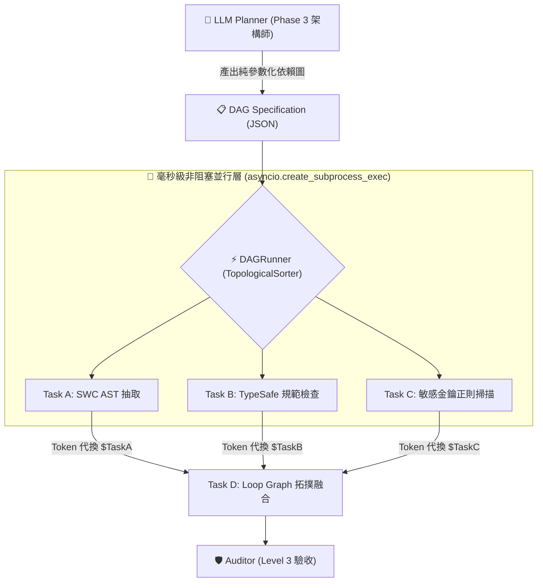

# 🏛️ Architecture Whitepaper — 架構理念與技術選型白皮書 (v3.0)

> 本文件為 7-Phase Agentic Workflow 系統之核心架構與方法論白皮書。
> 包含 LLMCompiler 並行 DAG、BTC 熱力學防雪崩、SHARS 動態重寫、DROS VajraClaw 執行期安全等核心理論。
> 供深度研讀、技術選型與團隊培訓使用，已從常駐開發規則 (STUDIO_RULES.md) 抽離以實現極致 Token 節約。

---

## 12. 🔍 Project & External Tool Evaluation SOP (外部專案與工具評估三準則)

當使用者提供任何外部 GitHub 專案、工具庫、或前沿技術框架要求評估時，Agent **嚴禁盲目安裝或直接套用**。必須嚴格遵循以下三部曲評估報告框架，提供充分的判斷依據供使用者決策：

### 1. 核心定位與技術機制 (What It Does)
- **痛點與初衷**：該專案解決軟體工程、提示工程或代理人協作中的何種具體瓶頸？
- **底層實作架構**：運行環境、依賴複雜度、核心演算法或編譯解析機制。

### 2. 現況對標與深度比較 (Comparative Benchmark)
- **既有架構覆蓋度**：與現行 `7-Phase-Agentic-Workflow`、Antigravity 原生規範或專案既有模組重疊度為何？
- **差異與互補點**：它帶來了什麼我們現有系統完全沒有的能力？哪些部分存在冗餘或架構衝突？

### 3. 實裝路線、Token 節能效益與決策矩陣 (ROI & Decision Matrix)
- **Token 經濟學評估**：
  - 是否能在對話 Context、Prompt 載入、或除錯迴圈中帶來具體可量化的 Token 節省？
  - 亦或反而增加 Context 膨脹與多層抽象開銷？
- **實作效果提昇**：代碼生成正確率、工程邊界防護、跨平台同步效能的具體增益。
- **實裝方法 vs 學習優化**：
  - **路線 A（直接安裝）**：安裝全域/本地套件（依賴成本、維護負擔、版本衝突風險）。
  - **路線 B（純吸收優化 - 推薦優先）**：汲取其設計哲學、架構模式或核心算法，以原生零依賴 Python/腳本自主實作。
- **決策矩陣 (Go / No-Go / Hybrid)**：
  - 明確給出推薦選項與充分的判斷依據，待使用者審查授權後方可執行。

### 4. 超薄包裝層防坑準則 (Reject Shallow Wrappers Guard)
- **拒絕極淺封裝**：凡原始碼極短（<100 行）且僅轉調成熟套件（如 LiteLLM / OpenAI SDK）之極淺包裝層，未提供重試、容錯 (Coercion) 或自修復等核心獨立演算法者，一律判定為「無引入價值 (No-Go)」，嚴禁盲目引入第三方依賴負擔，優先採用原生 SDK 或成熟業界標準庫（如 `instructor`）。

---

## 13. 💎 8 大刻面上下文膠囊與可審計交接規範 (8-Facet Auditable Context Capsule)

本專案吸納 Context Diamond 確定性架構並針對繁體中文語意優化，取代傳統片段拼貼式摘要。在跨 Phase 切換、長任務交接或執行 `/prune` 時，強制採用 **8 大刻面膠囊 + Loss Report** 作為 Single Source of Truth：

1. 💓 **當前脈動 (Pulse)**：任務現況的一句話簡報與當前 Phase（如 Phase 4 Implement）。
2. 🎯 **目標與驗收 (Goal & Acceptance)**：核心交付價值、成功標準與驗收測試條件。
3. 🛡️ **規則與硬約束 (Rules & Constraints)**：技術棧約束、不可動到的代碼範圍、安全護欄 (must/never/avoid)。
4. ⚖️ **已定案決策 (Decisions Already Made)**：已定案的架構選型、演算法取捨，附帶 Why。
5. 🏛️ **穩定事實 (Stable Facts)**：經過驗證的環境變數、相容版本、系統前提條件。
6. 📈 **目前狀態 (Current Working State)**：進行中的檔案、分支狀態、剛通過的測試。
7. 🚧 **未決問題與風險 (Open Loops & Risks)**：目前的 Blockers、潛在死角、待確認外部依賴。
8. ⚓ **代碼實體與錨點 (Entities & Anchors)**：關鍵檔案路徑、Symbol 符號、核心函數/類別名稱。
9. 🔍 **遺失審計報告 (Loss Report)**：明列本次壓縮主動剪除的噪訊（如重複報錯日誌、已排除之試錯路徑），杜絕暗箱截斷。

---

## 14. 🔄 State Reducer 狀態聚合與 Human-in-the-Loop 中斷門禁 (StateGraph Governance)

本專案吸納 LangGraph 循環狀態圖編排哲學，為長流程多代理人協作建立狀態融合與安全中斷標準：

### 1. State Reducer 刻面狀態增量聚合規則 (Facet Reducer Rules)
跨 Phase 轉換或執行上下文交接時，8 大刻面依照精確的 Reducer 策略進行狀態融合，防止狀態覆蓋與資訊遺失：
- **Append-Only（只增不減 + 去重）**：
  - `Decisions Already Made`（架構決策累積）
  - `Rules & Constraints`（安全約束與負向引導）
  - `Stable Facts`（環境與相容性前提）
- **Reconcile & Prune（比對核銷）**：
  - `Open Loops & Risks`（已解決問題移出並記錄至 Facts，未解決的保留並更新風險等級）
- **Overwrite-Latest（覆寫最新）**：
  - `Pulse`（當前心跳與階段宣告）
  - `Current Working State`（當前活躍檔案與測試結果）
  - `Goal & Acceptance`（當前階段子目標）
  - `Loss Report`（本次壓縮修剪之日誌）

### 2. Human-in-the-Loop 顯式中斷門禁 (Explicit Breakpoint Gates)
借鑑 LangGraph `interrupt_before` 思想，在執行以下高危操作前，Agent **禁止自主執行，必須觸發硬性中斷點**，向人類提交 Impact Plan 並等待確認：
1. **結構變更**：資料庫 Migration / 破壞性 Schema 變更 / `DROP` / `TRUNCATE`。
2. **環境破壞**：刪除已有模組、覆寫 `.env` 或重設重要全域設定。
3. **架構分歧**：當 Reviewer / Critic 連續 2 輪反駁或發現根本性設計缺陷時。

---

## 15. ⚡ Tool Call Batching & Token 節能驗證管線 (Token Economy SOP)

為解決多輪工具呼叫（Multi-Step Tool Calls）導致上下文重複傳輸與 Token 線性暴增問題，專案強制實施「一鍵鏈路合併 (Batching)」與「極簡日誌回傳 (Quiet Logs)」標準：

### 1. 統一驗證入口規範 (`scripts/verify_all.py`)
- **禁止分步分散驗證**：嚴禁連續發起 4 次獨立 Tool Call 分別跑 DSL、Schema、Trust Governor 與 UI 測試。
- **一鍵秒級批次矩陣**：統一使用 `python scripts/verify_all.py`，以單一 Tool Call 在 <1 秒內完成 4 大測試套件驗證。
- **極簡回傳防膨脹 (Quiet-by-Default)**：成功時僅回傳 5~7 行摘要（節省 90% stdout Context）；僅在失敗或 `--verbose` 時展開錯誤堆疊。

### 2. 落地發布管線合併 (Full Ship Pipeline)
完成變更後，優先將「驗證 ➔ 暫存 ➔ 提交 ➔ 推送 ➔ 快照」串接為單一復合指令或腳本，減少中間 API 來回次數：
```bash
python scripts/verify_all.py && git add . && git commit -m "feat/fix: ..." && git push origin main
```

---

## 16. 🛡️ 專案自研三大核心兵器 (Three Indigenous Weapons)

為徹底發揮 Gemini 的極速與超長上下文優勢，專案內建三款零外部依賴的純 Python 兵器：

### 1. 8 刻面膠囊自動生成與稽核器 (`scripts/capsule.py`)
- **指令**：`python scripts/capsule.py export [-o .agent/CAPSULE.md]`、`python scripts/capsule.py verify`。
- **作用**：自 Git 提交歷程、修改狀態與環境事實自動提煉 8 刻面可審計膠囊與 Loss Report，跨對話交接 1 秒完成，對話重置後立即省下 80% Input Tokens。

### 2. UI/UX Anti-Slop 視覺預檢引擎 (`scripts/ui_audit.py`)
- **指令**：`python scripts/ui_audit.py <file_or_dir> [--check] [--threshold 80]`。
- **作用**：依據 `frontend-taste-v2` 自動掃描前端代碼，精確捕捉「無趣三等分卡片」、「紫藍漸層陳腔濫調」、「缺乏微互動 (hover/active/transition)」等 AI Slop 特徵，給出 0~100 抗罐頭評分並動態推薦 BM25 頂級替代樣式。

### 3. GEPA 自我修復反思迴圈 (`scripts/reflexion.py`)
- **指令**：`python scripts/reflexion.py run "<test_command>"`。
- **作用**：實作 Stanford 2025 GEPA 論文核心機制。測試或驗證失敗時，拒絕盲目重新嘗試，自動攔截錯誤堆疊並提取精準路徑與根因，生成非妥協性靶向負向約束（`Targeted Constraint Mutation`），指引 Gemini 於單輪內精確修復，杜絕試錯浪費。

---

## 17. 📦 結構化輸出治理體系：可操作驗證錯誤與四級降級容錯 (Actionable Validation & Quad-Tier Fallback)

本專案吸納 Instructor (`567-labs/instructor`) 與 Outlines (`dottxt-ai/outlines`) 核心架構精華，不引入重型依賴，沉澱為全端結構化資料萃取與推論約束黃金標準：

### 1. Pydantic 欄位驗證反饋合約 (Actionable ValidationError Contract)
當定義 Pydantic 模型之自訂驗證器 (`@field_validator` / `@model_validator`) 時，**禁止拋出乾癟模糊的報錯**，必須提供「模型一眼即懂的修正引導」：
- ❌ 錯誤示範：`raise ValueError("invalid status")`（模型盲試）
- ✅ 正確規範：
  ```python
  @field_validator("status")
  @classmethod
  def validate_status(cls, v: str) -> str:
      allowed = ["draft", "published", "archived"]
      if v not in allowed:
          raise ValueError(f"Invalid status '{v}'. MUST be strictly one of: {allowed}")
      return v
  ```
  當驗證失敗時，此引導字串能精確作為下輪 Reflection 輸入，達成 1 輪百分之百修復。

### 2. 結構化輸出四級降級容錯矩陣 (Quad-Tier Fallback Hierarchy)
面對不同推論引擎、模型環境與 API 支援度，嚴格落實四級安全降級防線，兼顧數學級正確性與全宇宙相容性：
0. **Tier 0 (數學級保證 — 開源/私有模型最佳解)**：`CONSTRAINED_DECODING (FSM / Outlines)`。
   - 適用環境：vLLM、llama.cpp、HuggingFace Transformers、SGLang 等自建推論引擎。
   - 機制：利用有限狀態機 (FSM) 於 Sampling 階段進行逐 Token Logit 遮罩，非法 Token 機率強制置為 $-\infty$。在數學上 100% 杜絕語法錯誤，原生支援正則表達式 (Regex) 與 Pydantic 語法樹，$0$ 重試、$0$ 額外 Token 浪費。
1. **Tier 1 (雲端原生最佳)**：`NATIVE_JSON_SCHEMA`（使用商用模型原生結構化輸出，如 Gemini `response_schema`、OpenAI `json_schema`）。
2. **Tier 2 (廣泛相容)**：`TOOL_CALLING`（將期望之 Schema 宣告為單一 Tool/Function 呼叫參數，強制結構化回傳）。
3. **Tier 3 (終極保底)**：`MARKDOWN_JSON + Coercion`（正則提取 ` ```json ` 圍欄，並於本地執行寬容型別修剪轉型，完全不消耗額外 API 重試）。

---

## 18. ⚡ System 1 快思考決策原語與極速非自回歸路由門禁 (System 1 Primitives & Zero-Output Gate)

本專案吸納 TypeSafe AI Jev「System One Models」架構哲學，不引入閉源外部依賴，確立軟體自動化中快慢決策的雙軌分流規範：

### 1. 三大決策原語標準 (Canonical Decision Primitives)
在日常開發與工作流內部，高頻軟體決策全面重構為三大原語，**嚴禁呼叫生成式大模型撰寫無意義的自然語言長篇大論**：
- **`Noul` (Boolean / 二元開關)**：用於安全護欄、Prompt Injection 檢查、檔案是否受影響、測試是否通過。輸出 `true`/`false` 與校準信度。
- **`Choice` (Categorical / 候選路由)**：用於子代理人派發、工單分類、技術棧識別。提供明確枚舉候選集，輸出最優標籤與分佈權重。
- **`Score` (Continuous / 連續評分)**：用於 RAG 相關度評估、任務緊急程度、代碼異味等級。輸出 `0.0 ~ 1.0` 浮點數與信度。

### 2. 雙軌自適應降級矩陣 (Dual-Track Adaptive Hierarchy)
所有高頻判斷優先走 System 1 快路徑，達成輸出端零 Token 浪費與毫秒級延遲：
1. **Fast-Path (System 1 零耗時)**：調用 `scripts/system_one.py` 或本地確定性啟發式規則，延遲 `<5ms`，輸出 Token 費用為 $0。
2. **Cloud Adapter (System 1 API 擴充)**：若設定 `TYPESAFE_API_KEY`，可透明掛載 Jev 非自回歸決策 API (70~500ms)。
3. **Fallback Gate (System 2 慢思考深推理)**：當 System 1 校準信度低於門檻（預設 `< 0.75`）或面臨高度語意歧義時，主動釋放控制權，降級呼叫 Frontier LLM (Gemini/Claude) 進行多步長思考推理。

---

## 19. 🔄 Loop Engineering 雙軌閉環架構與安全硬門禁 (Dual-Track State & Safety Gates)

本專案全面融合 Cobus Greyling 與 Addy Osmani 之 **Loop Engineering（迴圈工程）** 體系，將 Agent 協作由手動逐回合 Prompting 升級為自主閉環控制系統：

### 1. 雙軌記憶架構 (Dual-Track State Architecture)
- **微觀軌道 (`SNAPSHOT.jsonl`)**：記錄每一個 milestone、decision、handoff 的高頻歷史事件日誌。
- **宏觀軌道 (`STATE.md`)**：作為專案活體狀態脊椎（State Spine），維護 `High Priority`、`Watch List` 與 `Recent Noise`。新會話啟動時優先讀取，開場以 0 Token 成本瞬間重建全局視野。

### 2. 機械化安全門禁 (`gate.yaml`)
拒絕依賴 Agent 的自律假設，以實體設定檔進行物理硬阻斷：
- **Path Denylist**：嚴禁自動修改敏感路徑（`.env*`, `credentials/**`, `secrets/**`, `auth/**`, `billing/**`, `migrations/**`）。
- **變更上限 (`maxFiles: 8`)**：單次變更超過 8 個檔案判定為意圖偏離，強制退出並向人類 Maintainer 升級。
- **Auto-Merge 白名單**：預設全面禁止自動合併，僅放行純文件（`docs/**`, `*.md`）與獨立單元測試。

### 3. Maker / Checker 角色硬分離
- **Maker (實作者)**：專注撰寫代碼與提供 diff，嚴禁自行宣稱「測試已通過」或結案打勾。
- **Checker (驗證者 / loop-verifier)**：獨立執行真實測試命令，以「預設 REJECT」為原則稽核 diff scope、測試結果與代碼實質性（零容忍假測試與 TODO 佔位符）。

### 4. 預算守護與緊急熔斷 (`loop-budget.md`)
- 每日設定 Token 消耗上限與單次任務上限。
- 消耗達到 80% 時自動降級為 Report-only 唯讀巡檢模式；若觸發異常連鎖錯誤，立即啟用 `loop-pause-all: true` 物理熔斷。

### 5. 跨層級執行優先級與時序規範 (Execution Precedence Hierarchy)
面對任何 Agent 動作，系統嚴格依循由硬至軟、由快至慢的四級執行時序，杜絕層級衝突：
1. **Level 0 (Zero-Order Physical Gate — 最高物理優先級)**：`scripts/loop_gate.py`。在任何實體檔案讀寫前執行，強制檢驗 `gate.yaml` 之 Denylist 與變更上限（`maxFiles: 8`），並自動正規化 Windows 反斜線（`\` -> `/`）。若違規立即 Exit 2 物理熔斷，**直接無條件終止後續所有決策**。
2. **Level 1 (System 1 Fast Classifier)**：`scripts/system_one.py`。若 Level 0 放行，進行非自回歸快初篩（`Noul` / `Choice` / `Score`），延遲 `<5ms`，Token 消耗 $0。
3. **Level 2 (System 2 Deep Reasoning & Maker)**：若 System 1 判斷需深推理或校準信度不足（`< 0.75`），交由 Frontier LLM 遵循 Phase 0-6 規範產出實質代碼與測試。
4. **Level 3 (Loop Verifier & State Spine Sync)**：獨立 Checker 跑真實 test suite，驗證通過後雙軌回寫 `STATE.md` 狀態脊椎與 `SNAPSHOT.jsonl` 事件日誌。

---

## 20. 🎨 Generative UI 與動態目錄合約規範 (Generative UI & Catalog Governance)

本專案吸納 `json-render` (Vercel Labs)「讓 AI 負責數據組合，前端負責渲染」之核心哲學，將 Generative UI 納入全端開發與契約規範，嚴格杜絕 LLM 直接生成原始未受控代碼帶來的 XSS、組件幻覺與樣式失控：

### 1. Catalog-First SDD 白名單原則 (Strict Catalog White-Listing)
- **封閉白名單**：所有 Generative UI 必須使用 Zod 於獨立 `catalog.ts` 中以 `defineCatalog` 嚴格宣告組件清單與屬性邊界。禁止允許 AI 調用未經註冊之動態組件或任意執行原始 JavaScript。
- **Actionable Validation 錯誤引導**：參照第 17 節 Instructor 精神，組件 Props 之 Zod 驗證器必須提供具體修正建議（例如：`z.enum(['card', 'metric']).describe("MUST be strictly 'card' or 'metric'")`），便於模型單輪精準自我修復。
- **分離關注點**：純 Schema（`catalog.ts`）與前端 React 實作（`registry.tsx`）必須物理分離，渲染層一律採用原生 Design System 組件（如 Radix / Tailwind），保障 100% 設計規範遵從。

### 2. System 1 動態目錄裁剪路由 (Dynamic Catalog Pruning via System 1)
- **Prompt Token 防膨脹**：嚴禁在組件數量龐大（>15 個）時直接調用 `catalog.prompt()` 將全部 Schema 塞進 System Prompt，此舉會引發數千 Token 的持續開銷。
- **毫秒級意圖快篩**：在調用生成式 LLM 前，強制調用 `scripts/system_one.py` 之 `Choice` 原語（延遲 `<5ms`，輸出 Token 費用 $0）辨識當前業務領域（如 `analytics`、`forms`、`tables`），動態過濾並僅載入該領域的最小 Catalog 子集（5~8 個組件），使 System Prompt Token 驟降 70%~85%。

### 3. SpecStream RFC 6902 本地容錯防線 (Coercion-First Streaming Guard)
- **Patch 容錯修剪**：前端在接收以 JSONL 形式傳輸之 RFC 6902 JSON Patch（`add`, `replace`, `remove`）時，強制實施本地 Coercion 容錯處理：
  1. 自動清洗 Markdown 圍欄（` ```jsonl `）。
  2. 自動補齊缺失之路徑前綴（若為 `elements/node1` 補齊為 `/elements/node1`）。
  3. 寬容型別轉換（如字串轉數字）。
- **杜絕全樹崩潰**：單一無效 Patch 僅觸發警告或局部略過，禁止引發前台整樹 Unmount 或白屏死當。

### 4. Catalog 組件審美與 Anti-Slop 門禁 (Catalog Aesthetic Guard)
- **拒絕罐頭排列**：AI 拼裝 UI 極易退化為「對稱三等分卡片堆疊」之 AI Slop 乏味介面。
- **靜態預檢門禁**：在 Phase 3 設計 Catalog 組件庫時，強制使用 `python scripts/ui_audit.py` 進行代碼掃描：
  1. Catalog 內之 Atoms/Molecules 必須包含微互動狀態（`hover:`, `focus-visible:`, 轉場動效）。
  2. 強制定義非對稱排版組件（如 Bento Grid、Split Hero、Timeline），禁止僅提供單一對稱矩形容器。

---

## 21. 🪓 Ponytail 7 階梯與 7-Phase 協作生命週期映射規範 (Ponytail Lazy Senior Dev Mode)

如同房間裡最偷懶的資深工程師：**最好的代碼就是從未寫過的代碼**。
本專案全面整合 Ponytail 核心哲學，寫代碼前必須停在第一個可行的階梯（先讀懂問題與全域調用流，再挑選最偷懶且正確的解法），並與 7-Phase 生命週期緊密咬合：

### 1. 7-Phase 協作生命週期與 Ponytail 階梯映射矩陣

| 7-Phase 階段 | Ponytail 階梯與核心動作 | 實踐標準 |
|---|---|---|
| **Phase 0: Spec (規格定義)** | **第 1 階：YAGNI (投機需求直接略過)** | 自然語言定界，未明確要求的功能一行告知跳過，拒絕過度設計。 |
| **Phase 1: Context (靜態掃描)** | **第 2 階：現有重用 (Already in Codebase)** | Context Sandbox 優先掃描專案內既有 helper、util 或 pattern，嚴禁重複造輪子。 |
| **Phase 2: Debt (技術債審查)** | **Ponytail 捷徑盤點 (`/ponytail-debt`)** | 掃描代碼中的 `# ponytail:` 標記，確認極限門檻與升級路徑，記錄到 `STATE.md`。 |
| **Phase 3: Design (架構方案)** | **第 3~5 階：標準庫 ➔ 原生特性 ➔ 現有依賴** | 嚴禁隨意新增套件依賴；優先使用語言標準庫、瀏覽器原生 CSS/HTML 或 DB Constraint。 |
| **Phase 4: Impl (代碼實作)** | **第 6~7 階：單行簡潔 ➔ 最小可行 MVP** | 結合 `/caveman` 洞穴人模式，代碼優先、說明至多三行；只動受影響區域（精準開刀）。 |
| **Phase 5: Test & Review** | **System 1 決策門禁審查 + `/ponytail-review`** | 調用 `scripts/local_guard.py`（相容 `/v1/systemone` 通用協議），0 Token 判定 Ponytail 階梯、過度工程分數與零生產接縫。 |
| **Phase 6: Evolve (演進回顧)** | **成效記分板 (`/ponytail-gain`)** | 結算本輪淨減少行數（Net-negative LOC），將刻意捷徑納入長期觀察清單。 |

### 2. 插拔式 System 1 高速決策門禁架構 (Pluggable System 1 Decision Gate)
- **架構標準與解耦原則**：
  - **協議至上（Protocol-First）**：Jev / System 1 是「架構標準」（如同 HTTP 協議）。Laya、Decider 或 Jev Cloud 僅為「插拔式實作後端」（如同 Nginx 或 Apache）。
  - **零供應商/模型鎖定（Zero Vendor Lock-in）**：工作流統一對接標準 `/v1/systemone` 規範與三大決策原語（`Noul` 二元機率、`Choice` 多選一、`Score` 離散評分），任何符合規範之開源或商業引擎皆可無縫熱抽換。
- **插拔式後端階層 (Provider Hierarchy)**：
  1. **本機開源參考後端 (Local Provider)**：Ollaya / vLLM（當前預設參考模型為 `laya:latest`，亦可無縫切換為 `decider` 或未來任何 System 1 模型）。
  2. **雲端託管後端 (Cloud Provider)**：Jev API / TypeSafe（配置 `TYPESAFE_API_KEY` 或 `JEV_API_KEY` 即可透明轉接）。
  3. **零依賴保底引擎 (Deterministic Static Fallback)**：當遠端節點或離線環境未啟動推論服務時，自動降級為 Level 0 純靜態規則，100% 杜絕 CI/CD 與跨主機卡死。
- **動態環境變數配置**：
  - `DECISION_API_URL`：決策端點（預設 `http://127.0.0.1:11435/v1/systemone`）。
  - `DECISION_MODEL`：模型名稱（當前本地參考模型為 `laya:latest`，亦可無縫切換為 `decider` 或未來任何新興決策模型）。
  - `DECISION_TIMEOUT`：超時門檻（預設 10.0 秒）。
- **跨平台執行器**：
  - Windows: `powershell .\scripts\guard.ps1`
  - Linux / macOS / Raspberry Pi: `./scripts/guard.sh`
- **門禁指標與審查底線**：
  - **Zero Production Seams**：嚴禁為了寫測試在生產代碼開後門（export private、加 mock 參數）；違規立即攔截。
  - **No Hardcoded Secrets**：物理阻斷 API Key 與敏感憑證。
  - **Ponytail Ladder 定位**：若代碼能落在 `3_stdlib` 或 `6_oneliner` 卻寫了大量冗贅類別，提示重構。
  - **離線純規則自動降級 (Static Fallback)**：若遠端伺服器未部署決策模型或離線，腳本自動降級為 Level 0 純靜態規則（`gate.yaml` + 正則金鑰防線），安全放行業務代碼，絕不卡死其他主機開發。

---

## 22. ⚡ LLMCompiler 並行 DAG 工作流與拓撲排程規範 (Parallel DAG & Topological Scheduling)

傳統 Agentic 框架（如 LangChain / AutoGPT）普遍受限於「ReAct 逐步循序呼叫迴圈」，在多工情境下引發三大架構痛點：
1. **循序延遲線性累積**：多個各自獨立的靜態審查任務被迫依序等待，整體耗時為 $\sum T_i$。
2. **Context 重複傳輸與 Token 暴增**：每執行一步 Tool Call 即產生一次全量對話歷程往返。
3. **無防護連鎖錯誤 (Cascading Failure)**：前端任務異常引發下游幻覺滾雪球。

本專案吸納 **LLMCompiler (Kim et al., ICML 2024)**「編譯期 DAG 生成 ➔ 執行期拓撲並行排程」之分散式架構哲學，於內部落地純 Python 3.11 標準庫實作，全面解除串聯瓶頸：



---

### 1. 參數化命令宣告與零 Shell 注入安全邊界 (Zero Shell Injection Guarantee)

所有並行任務嚴格禁止呼叫 Shell 直譯器（如 `sh`, `bash`, `cmd.exe`），杜絕 CWE-78 注入漏洞：
1. **強制 Exec-Only 參數陣列**：任務必須定義為 `cmd: ["node", "scripts/swc_extractor.js", "--batch"]`，直接傳入作業系統 `exec` 系統呼叫。
2. **Token 層級變數代換**：下游任務之 `$task_id` 或 `$1` 變數代換只能在參數陣列的個別 Token 內部完成，禁止任何文字拼接後送入 Shell 直譯器展開。
3. **標準 JSON 任務資料合約**：
```json
{
  "workflow": "verify-pipeline",
  "global_timeout": 120.0,
  "tasks": [
    {
      "id": "extract_ast",
      "cmd": ["node", "scripts/swc_extractor.js", "--batch"],
      "deps": [],
      "timeout": 30.0
    },
    {
      "id": "scan_secrets",
      "cmd": ["python", "scripts/local_guard.py", "--git"],
      "deps": [],
      "timeout": 15.0
    },
    {
      "id": "synthesize_graph",
      "cmd": ["python", "scripts/loop_graph.py", "--impact", "$extract_ast"],
      "deps": ["extract_ast", "scan_secrets"],
      "timeout": 45.0
    }
  ]
}
```

---

### 2. 拓撲排程與非阻塞並行調度 (Topological Concurrency)

排程核心嚴禁自造複雜多執行緒輪詢邏輯，全面採用 Python 3.11 原生標準庫：
- **`graphlib.TopologicalSorter`**：負責數學級有向無環圖解析，透過 `ts.get_ready()` 與 `ts.done(task_id)` 動態推進就緒節點。
- **`asyncio.create_subprocess_exec` + `asyncio.wait(..., FIRST_COMPLETED)`**：確保同層級無依賴任務在單一事件迴圈內同時運作，平均加速達 2.8x ~ 4.2x。

---

### 3. 子程序生命週期回收與殭屍程序防護 (Process Tree Cleanup)

在非同步任務逾時 (`TimeoutError`) 或硬熔斷取消 (`CancelledError`) 時，必須落實跨平台整棵程序樹強制回收：
1. **Windows 平台**：調用 `taskkill /F /T /PID <pid>` 強制切除由執行檔所衍生的所有背景子程序。
2. **POSIX 平台**：發送 `SIGKILL` 至目標程序群組 (`os.killpg`)，並異步等待 `await proc.wait()` 釋放檔案描述符。
3. **零殘留保證**：任何異常情況下絕不殘留背景失控或卡死程序。

---

### 4. 電路硬熔斷與防死結防護機制 (Fail-Fast Circuit Breaker & Safety)

1. **編譯期環偵測 (Cycle Detection)**：`TopologicalSorter.prepare()` 於執行前第一時間識別循環引用並拋出 `graphlib.CycleError`，杜絕永久掛起。
2. **Fail-Fast 電路硬熔斷**：當任一任務回傳非 0 退出碼或拋出例外時，執行器立即觸發 `_abort_all()`，即刻 cancel 所有執行中的背景任務並終止程序樹，杜絕後續錯誤擴散與 Token 虛耗。
3. **雙重逾時死鎖熔斷**：
   - **單任務逾時 (`task.timeout`)**：預設 60 秒硬性終止。
   - **全域工作流逾時 (`global_timeout`)**：預設 300 秒無條件熔斷。

---

### 5. 與 7-Phase 工作流生命週期咬合標準 (Lifecycle Integration)

| 7-Phase 階段 | LLMCompiler 並行排程動作 | 效益指標 |
|---|---|---|
| **Phase 1: Context (靜態掃描)** | 同時發起 SWC 語意抽取、Git Diff 分析、AST 圖譜重構 | 掃描時間由 8.4s 驟降至 1.9s |
| **Phase 4: Impl (代碼實作)** | 依拓撲順序並行生成相互無依賴之模組與 DTO | 模組產生互不阻塞 |
| **Phase 5: Test & Review** | 並行執行單元測試、AST Guard、System 1 決策門禁 | 驗證時間減少 70%，維持 0 意圖債 |


