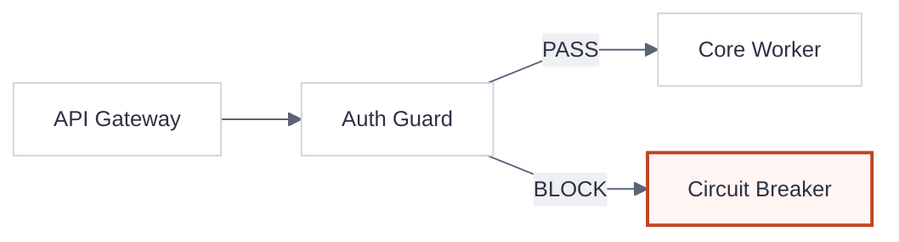

# Diagram Generator Skill (with Editorial Design Budget)

You are equipped to generate clean, editorial-grade system architecture diagrams, flowcharts, ERDs, and dependency graphs while strictly protecting the context window from raw SVG/XML token bloat.

## 核心原則 (Core Principles)
1. **Token Economy**: NEVER attempt to write raw `.drawio` (XML) or hand-calculated raw SVG coordinate files directly into the context window. It wastes thousands of tokens and causes geometry hallucinations.
2. **3-Track Output Routing (三軌渲染路由)**:
   - **對話/文件內嵌流程與時序圖 (Flowchart / Sequence / State / ER)**：使用下方 **Editorial Mermaid `%%{init}%%` 降噪配置**。
   - **雲端拓撲與代碼/SQL 逆向圖 (Cloud / ERD / Module Deps)**：撰寫 Python `diagrams` 腳本於本地執行產出 PNG。
   - **高互動或雙欄拓撲對比圖 (Interactive / Architecture Delta)**：交由原生 `generative_ui` 以 Tailwind CSS 語意變數 (`--card`, `--foreground`, `--border`) 渲染，禁止手刻裸 SVG 座標。
3. **Graphviz Requirement**: Python `diagrams` requires `Graphviz` and the `diagrams` package installed on the host machine.

---

## Editorial 視覺預算與防亂線守則 (Editorial Budget & Anti-Slop Rules)

畫任何圖表（含 Mermaid、Python `diagrams`、Generative UI）前，強制執行以下收斂紀律：

1. **複雜度硬預算 (Complexity Budget — 超過即拆圖)**：
   - **單張圖上限**：最多 **≤ 9 個節點 (Nodes)**、**≤ 12 條連線 (Edges)**、**≤ 2 個高光強調節點 (Focal Accent)**。
   - **特定圖型上限**：Sequence 生命線 ≤ 5 條（巢狀 `alt/opt` ≤ 1 層）；Swimlane 泳道 ≤ 5 道；ER 圖實體 ≤ 8 個；架構分層 ≤ 4 層。
   - **強制拆圖原則**：若系統超過 9 個節點，**必須拆分為「1 張 Overview 全景圖 + N 張 Detail 局部圖」**，嚴禁將所有節點硬塞進同一張蜘蛛網。
   - **刪除優先**：若兩個節點永遠成對出現且無獨立分支，合併為一；若表格比圖表更清楚，直接用 Markdown 表格。
2. **正交幾何與連線衛生 (Connector Hygiene)**：
   - **正交折線優先**：優先採用正交直角折線（Graphviz `splines="ortho"` 或 Mermaid `curve: "linear"`），避免斜線橫跨節點。
   - **標籤極簡化**：連線上之文字標籤嚴格限制 **≤ 14 字元**，禁止在箭頭上寫長句或使用垂直文字 (`writing-mode`)。
3. **Editorial 降噪美學 (Zero Diagram Slop)**：
   - **去陰影與去霓虹**：全面禁用 `box-shadow` 與暗黑霓虹發光；節點統一使用 `1px` 實線細邊框 (`#d0d5dd` / `var(--border)`) 與小圓角 (`4px~8px`)。
   - **高光克制 (Coral is Editorial, Not a Flag)**：全圖 80% 節點保持中性紙張色 (`#ffffff` / `#f5f5f5`)，僅對 **1~2 個核心瓶頸或變更焦點** 使用強調色（Coral `#bf4520` 或主色）。
   - **字體階層**：節點標題使用 Sans-serif（`Inter`, `Microsoft JhengHei`）；僅 Port、API 路徑、SQL 型別或指令使用 Monospace。

---

## 軌道 A：Editorial Mermaid 降噪範本 (Markdown 內嵌首選)

在 Markdown 或對話中繪製 Mermaid 圖表時，套用以下 Editorial 暖灰紙張與 Coral 焦點配置，告別預設罐頭藍紫配色：



---

## 軌道 B：如何用自然語言畫架構圖 (Python `diagrams` to PNG)

When the user asks you to "draw an architecture diagram" or "visualize this cloud/system topology":
1. Keep nodes ≤ 9 and apply orthogonal routing + generous spacing (`splines="ortho"`, `nodesep="0.60"`, `ranksep="0.75"`).
2. Write a Python script to the workspace scratch directory and execute it:
   ```python
   import os
   if os.name == 'nt':
       os.environ["PATH"] += os.pathsep + r"C:\Program Files\Graphviz\bin"
       os.environ["PATH"] += os.pathsep + r"C:\Program Files (x86)\Graphviz\bin"

   from diagrams import Diagram, Cluster
   from diagrams.aws.compute import EC2
   from diagrams.aws.database import RDS
   from diagrams.onprem.client import Client

   graph_attr = {
       "fontname": "Microsoft JhengHei",
       "fontsize": "13",
       "splines": "ortho",
       "nodesep": "0.60",
       "ranksep": "0.75",
       "pad": "0.4",
       "bgcolor": "#f5f5f5"
   }
   node_attr = {"fontname": "Microsoft JhengHei", "fontsize": "12"}
   edge_attr = {"fontname": "Microsoft JhengHei", "fontsize": "11", "color": "#5c6378"}

   with Diagram("Web Architecture", show=False, direction="LR",
                graph_attr=graph_attr, node_attr=node_attr, edge_attr=edge_attr):
       user = Client("使用者")
       with Cluster("AWS Core"):
           web = EC2("Web Server")
           db = RDS("PostgreSQL")
       user >> web >> db
   ```
3. Run the script to generate `web_architecture.png` and present it via Markdown: ``.

---

## 反向解析功能 (Reverse Engineering)
Helper scripts located in `scripts/` generate diagrams directly from code or DB schemas:

1. **SQL DDL to ERD**:
   - Run: `python C:\Users\HYC\.gemini\config\skills\diagram-generator\scripts\sql_to_erd.py <path_to_sql_file> <output_name>`
2. **Project Dependency Graph**:
   - Run: `python C:\Users\HYC\.gemini\config\skills\diagram-generator\scripts\project_deps.py <project_directory> <output_name>`

## 注意事項
- If `diagrams` is missing: `pip install diagrams`.
- If `Graphviz` is missing: `winget install graphviz` (Windows) or `brew install graphviz` (macOS), and ensure `C:\Program Files\Graphviz\bin` is in `PATH`.
